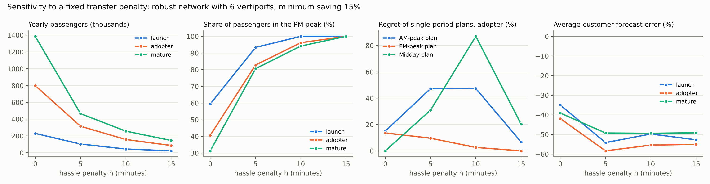

# Vertiport Planning in Chicago: Heterogeneous Customers and Time of Day

**Where should a city build its first air-taxi vertiports? Does the answer change when travelers differ, and when demand changes during the day?**

This project rebuilds the vertiport location model of Wang, Jacquillat and Vaze (2022, *M&SOM*) in a simpler form. It checks the simple model against the paper's New York results. It then applies it to 6.2 million Chicago rideshare trips from March 2026.

<p align="center">
  
</p>

## Key findings

All numbers are for the *adopter* scenario ($15 + $3.50 per mile, median value of time $31 per hour), unless stated otherwise.

1. **A few big hubs, centered on O'Hare.** Six vertiports carry about **800,000 passengers a year**: O'Hare, Midway, Near North Side, Loop, Lake View and Vertiport Chicago. The 90% bootstrap interval is 630,000 to 940,000. Most trips start or end at O'Hare. Two sites already capture a third of what ten sites capture. The same six sites are chosen in **98% of 200 bootstrap resamples** of the month's days. They are also the best network across seasons: planned on July 2025, January 2026 and March 2026 together, the network loses 0% in each month.
2. **RQ1: the "average customer" model picks the right sites but predicts the wrong numbers.** We estimate expectations separately for each origin-destination (OD) pair, instead of using one average for everyone. This barely changes *where* to build: under 5% of passengers in most cases. The loss reaches 12% at small budgets, and 29% in the thin launch market when all 77 areas are candidates. But the average-customer model **predicts 26 to 56% too few weekday passengers**. The gap is largest in the PM peak. In the launch scenario, the same model predicts too many passengers in quiet periods. The weekday gap stays between 28% and 49% in 90% of bootstrap resamples, so it is not a feature of one month.
3. **RQ2: do not design for the peak.** A network planned for one rush hour loses **up to 21 to 27% of yearly passengers**. This is the worst case over 4 to 8 vertiports, and it depends on the fare scenario. In the bootstrap, a peak-only plan loses more than 10% at some budget in **99.5% of resamples** (adopter; 100% for mature, 80% for launch). A network planned for midday usually stays within 5% of the best all-week network. This holds in 96 to 100% of resamples at most budgets, but only 66% at 5 vertiports. The result holds for three fare scenarios and two candidate sets (16 sites, or all 77 community areas). With tight vertiport capacity, the loss shrinks. The best all-week network is the same at every capacity level. But the "safe" single period depends on the assumptions and the season. With a transfer penalty, demand moves to the PM peak (finding 6). In January, a midday plan loses about 30%, while a PM plan loses almost nothing.
4. **The PM peak is the air-taxi rush hour.** It carries 433 passengers per hour on the robust network. This is more than twice the AM peak (199). With tight vertiport capacity, it is also the first period to lose passengers.
5. **The demand model matters more than any site choice.** We use expectations estimated from Chicago fares and travel times. With these, the paper's worst-case demand bound predicts about 30 times fewer passengers than the exact share.
6. **A transfer penalty changes how many people fly and when. It does not change the core network.** Neither the paper nor the main runs include a fixed "hassle" cost for changing vehicles. We add 5 to 15 minutes to every air-taxi trip. This cuts passengers by 60 to 90%. Most of the remaining passengers (80 to 100%) fly in the PM peak, when car trips are slowest. O'Hare, Near North Side, Loop and Lake View stay in the 6-site network. Midway and Vertiport Chicago become uncertain. The best single period to plan for moves from midday to the PM peak. This supports RQ2: the right single period depends on assumptions nobody knows yet, so the network should be planned across all periods. The average-customer model then predicts 50 to 60% too few passengers.

### Robustness at a glance

| What was varied | The 6-site network | RQ2: planning for one peak is costly | RQ1: average-customer model predicts too few |
|---|---|---|---|
| Fare and value of time (launch, adopter, mature) | stable | holds | holds |
| Candidate sites (16 sites; all 77 areas with 3 or 8 nearest vertiports) | stable | holds | holds |
| Day-to-day sampling (200 bootstrap resamples of March) | same in 98% | peak plan loses >10% in 99.5% | in 100% (28 to 49%) |
| Season (July 2025, January 2026, March 2026) | same in all three months | holds; the safe single period changes (midday, or PM in January) | holds (42 to 59%) |
| Vertiport capacity (no limit down to 50 passengers per hour) | same at every level | loss shrinks | not tested |
| Minimum time saving (0 or 15%) | stable | holds | holds |
| Transfer penalty (0 to 15 minutes) | O'Hare, Near North Side, Loop, Lake View stay | holds; the safe single period moves to PM | grows (50 to 60%) |

Flight overhead and pooling wait were not varied on their own. Each adds a few fixed minutes to the air-taxi trip, like the transfer penalty, so the penalty tests (0 to 15 minutes) cover them. Cruise speed has a similar effect. The spread of the value of time (coefficient of variation 0.84) was not varied. It is listed under future work.

<p align="center">
  
</p>


<details>
<summary>More figures: capacity, RQ1 and transfer penalty</summary>




</details>

## Method in brief

| Step | What it does |
|---|---|
| Demand data | Chicago rideshare trips (Transportation Network Providers), March 2026, from the City of Chicago open data (dataset `6dvr-xwnh`). Trips are grouped by pair of community areas and by period: AM 7-10, midday 10-16, PM 16-19, evening and night, weekend. Shared trips are removed. |
| Customer expectations (RQ1) | For each OD pair, the data server returns five averages: of 1/T, q/T, 1/T², q/T² and q²/T² (T = ride time, q = price). From them we get the mean and spread of the time saving a traveler needs, for any air-taxi fare. The value of time is lognormal (CV 0.84). Fare rounding is corrected. |
| Air-taxi option | A car ride to one of the 3 nearest vertiports, a 5-minute pooling wait, a flight at 200 km/h plus 10 minutes of fixed time, and a car ride to the destination. Only options that save at least 15% of the ground time are kept. An optional transfer penalty h (in minutes, `hassle_minutes` in the config) is added to the air-taxi time. h = 0 in the main runs, and 5 to 15 in the sensitivity analysis. |
| Switching share | The exact share under the stated distributions gives the main results. The paper's distributionally robust (Cantelli) bound is used for comparison. |
| Optimization | A mixed-integer program solved with Gurobi. It chooses p vertiports and sends each OD pair through at most one open pair. P1 covers one period. P2 uses one network for all periods and counts yearly passengers (250 weekdays and 115 weekend days). Capacity per vertiport and hour is optional. |
| Uncertainty | Day-level bootstrap: the 22 weekdays and 9 weekend days are resampled with replacement 200 times. For each resample, demand, ground times, options and shares are rebuilt. Every network with 2 to 8 sites is then evaluated exactly, by enumeration (Proposition 1). On the original month, this gives the same results as Gurobi. |
| Metrics | Value of heterogeneity: passengers lost when the network is planned with one average expectation. Regret: yearly passengers lost by a network planned for one period. Jaccard similarity: the share of sites two networks have in common. |

The full mathematical model is in [`docs/model_formulation_v1.1.pdf`](docs/model_formulation_v1.1.pdf). Version 1.1 updates the first version (19 October 2026). It adds the exact share, the minimum time saving, the capacity constraint, the transfer penalty and the robustness checks.

**Validation on New York.** We use the paper's uniform expectations and yellow-taxi data from March 2019. The simple model reproduces how the network grows in the paper's Table 4. As the required time saving falls from 0.40 to 0.33, it builds 3 to 7 vertiports, versus 3 to 10 in the paper. It also picks the paper's JFK site exactly.

## Reproducing the results

```bash
conda env create -f environment.yml
conda activate vertiport

python scripts/pull_chicago_daily.py 2026-03            # Chicago trips, one day at a time (resumable)
python scripts/build_chicago_instance.py                 # zones, candidates, ground times, options
python scripts/add_shares_v2.py                          # OD-specific and pooled switching shares
python scripts/solve_chicago_p1.py --scenario adopter --period weekday     # RQ1, one run
python scripts/solve_chicago_p2.py --scenario adopter                      # RQ2, robust vs single-period
python scripts/solve_chicago_p2cap.py                    # RQ2 with vertiport capacity
python scripts/bootstrap_days.py 200 && python scripts/summarize_bootstrap.py   # uncertainty (about 20 min, no solver needed)
python scripts/hassle_sensitivity.py                     # transfer penalty h = 0, 5, 10, 15 min (about 1 min)
python scripts/make_figures.py && python scripts/animate_day.py
```

Robustness runs: run `python scripts/build_chicago_instance.py config/chicago77k8.yaml`. Then pass `chicago77k8` to `add_shares_v2.py`, and `--instance chicago77k8` to the solvers. The community-area boundaries come from the City of Chicago data portal (*Boundaries - Community Areas*). They are saved as `data/raw/chicago/community_areas.geojson`. Raw and processed data are not tracked in git.

## Repository structure

```
config/       scenario and model parameters (YAML)
scripts/      data pulls, instance building, solvers, figures
results/      solver outputs (CSV), 16 candidate sites
results_chicago77*/   robustness runs with all 77 community areas
figures/      figures and the animated week
docs/         model formulation
```

## Limitations

- Ground times and prices are averages per period. Demand is spread evenly within each period.
- The pooling wait and detours are fixed. The shares can therefore be computed in advance, and the model stays linear. The paper instead models pooling and detours with queues.
- Air-taxi fares are scenarios, not observed prices. Ground prices surge, but the air-taxi fare does not.
- The capacity values (50 to 200 passengers per hour per vertiport) are illustrative. They still need support from the vertiport-capacity literature.
- The objective is passengers carried, not profit.
- The main runs have no fixed transfer ("hassle") cost, like the paper's utility. The paper's expectations come from surveys, which include such costs implicitly. Expectations from trip data do not. The 15% minimum saving is only a rough substitute. The sensitivity analysis shows that a 5-minute penalty already cuts demand by about 60%.
- The main results use March 2026. A seasonal check with July 2025 and January 2026 (`scripts/compare_months.py`) gives the same 6-site network. But yearly passengers, scaled up from one month, range from about 320,000 (January) to 1.55 million (July). Yearly totals are therefore uncertain. With 4 vertiports, the fourth site changes with the season (Loop or Lake View).

## Future work

- **Value of time by neighborhood and trip type.** All travelers share one value-of-time distribution, whatever their area or trip. The median could be scaled by community-area income (American Community Survey), with a higher value on airport trips. This would make expectations more realistic. It also raises an equity question: does a network that follows willingness to pay mainly serve high-income areas?
- **Shape of the value-of-time distribution.** Test a coefficient of variation from 0.5 to 1.2. Cut the lognormal at its 99th percentile, because a long tail can overstate demand.
- **Observed rather than assumed values of time.** The trip data do not show each traveler's value of time. It could be estimated from choices that trade price against time, such as standard versus premium ride-hail.
- **Estimated transfer penalty.** Replace the 0 to 15 minute tests with a value estimated from air-taxi choice surveys.
- **Operations.** Add back the paper's endogenous pooling wait and detours (second-order cone constraints). Demand and service quality would then be decided together.
- **Profit and pricing.** Maximize profit instead of passengers. Let fares change by route and time of day.
- **Seasons and capacity.** Extend the seasonal check to a full year. Base vertiport capacity on the vertiport-capacity literature.

## Reference

Wang, K., Jacquillat, A., and Vaze, V. (2022). Vertiport Planning for Urban Aerial Mobility: An Adaptive Discretization Approach. *Manufacturing & Service Operations Management*, 24(6), 3215-3235.

This is an independent student project. It is not affiliated with the authors of the paper.

## Acknowledgments

- **Model.** The modeling framework comes from Wang, Jacquillat and Vaze (2022): vertiport location with demand that depends on the air-taxi time saving, and the distributionally robust demand bound. This project uses a simplified version of their model.
- **Data.** Rideshare trips and community-area boundaries come from the [City of Chicago Data Portal](https://data.cityofchicago.org) (Transportation Network Providers trips, dataset `6dvr-xwnh`). New York validation data come from the [NYC Taxi and Limousine Commission](https://www.nyc.gov/site/tlc/about/tlc-trip-record-data.page) (yellow taxi trips, March 2019).
- **Software.** Optimization runs on [Gurobi](https://www.gurobi.com) under a free academic license. The analysis uses Python with NumPy, pandas, GeoPandas and Matplotlib.
- **Use of AI.** This project was developed with extensive help from an AI assistant (Claude, Anthropic). It wrote most of the code and documentation, proposed several modeling options and helped interpret the results. I chose the research direction, data and scenarios, made the final modeling decisions, ran the analyses and reviewed the results, and I am responsible for the content.

## Author

Gabriel Jonard, KU Leuven
