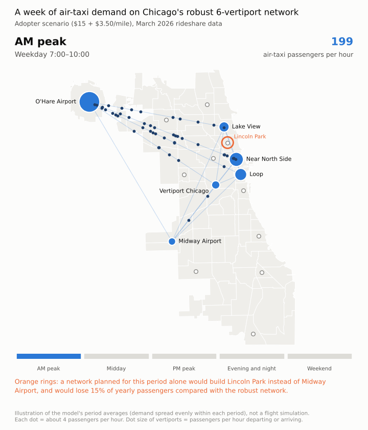
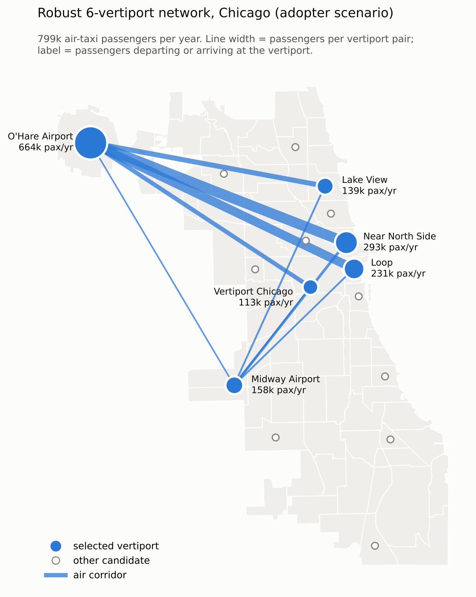
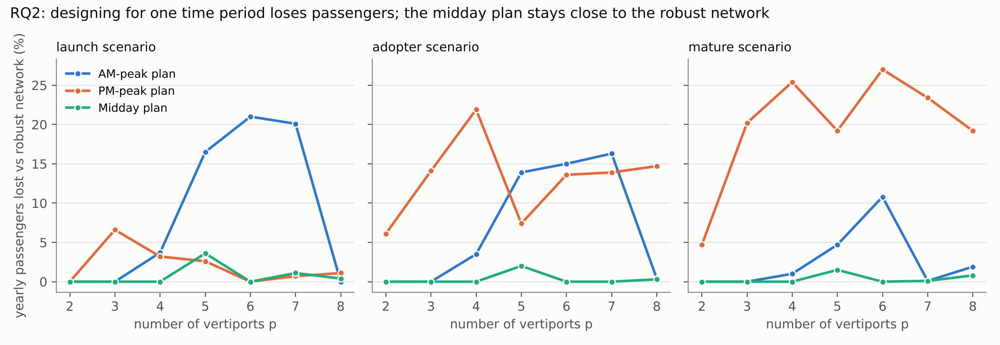
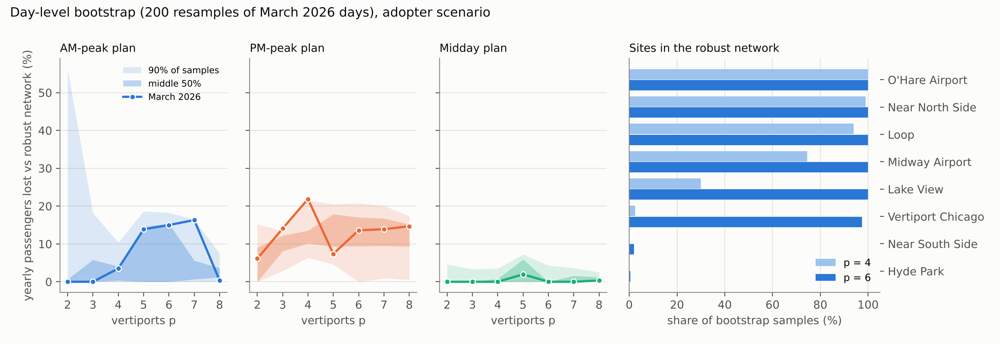
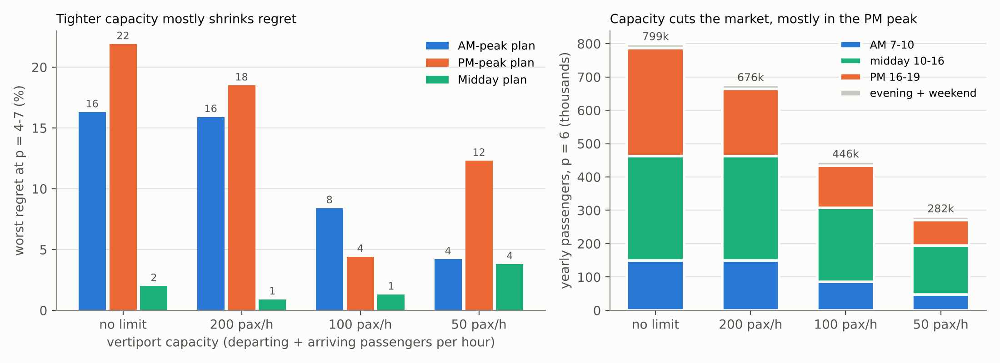
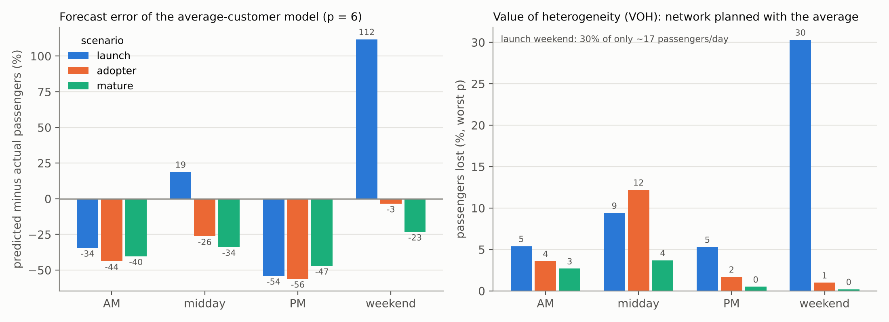

# Vertiport Planning in Chicago: Heterogeneous Customers and Time of Day

**Where should a city build its first air-taxi vertiports, and does the answer change when travelers differ and demand moves through the day?**

This project reproduces the vertiport location model of Wang, Jacquillat and Vaze (2022, *M&SOM*), validates a simplified version against the paper's New York results, and applies it to 6.2 million Chicago rideshare trips from March 2026.

<p align="center">
  
</p>

## Key findings

All numbers are for the *adopter* scenario ($15 + $3.50 per mile, median value of time $31/h) unless stated otherwise.

1. **A few big hubs, anchored on O'Hare.** Six vertiports (O'Hare, Midway, Near North Side, Loop, Lake View, Vertiport Chicago) carry about **800,000 passengers a year** (90% bootstrap interval 630,000 to 940,000), and O'Hare is at one end of most trips. Two sites already capture a third of what ten sites capture. The same six sites come out in **98% of 200 bootstrap resamples** of the month's days.
2. **RQ1: the "average customer" gets the place right but the numbers wrong.** Estimating expectations separately for each origin-destination pair, instead of using one average, barely changes *where* to build (under 5% of passengers in most cases; up to 12% at small budgets, and 29% in the thin launch market when all 77 areas are candidates). But the average-customer model **under-forecasts weekday demand by 26 to 56%**, worst in the PM peak, and over-forecasts quiet periods in the launch scenario. The weekday under-forecast is 28% in 90% of bootstrap resamples, so it is not an accident of one month.
3. **RQ2: do not design for the peak.** A network planned for one rush hour loses **up to 21 to 27% of yearly passengers** (worst case over 4 to 8 vertiports, depending on the fare scenario). In the bootstrap, a peak-only plan loses more than 10% at some budget in **99.5% of resamples** (adopter; 100% mature, 80% launch). A network planned for midday usually stays within 5% of the best all-week network (in 96 to 100% of resamples at most budgets, 66% at 5 vertiports). This holds across three fare scenarios and two candidate sets (16 sites or all 77 community areas). With tight vertiport capacity the loss shrinks, and the best all-week network stays the same at every capacity level.
4. **The PM peak is the air-taxi rush hour.** It carries 433 passengers per hour on the robust network, more than twice the AM peak (199). With tight vertiport capacity it is also the first period to be cut.
5. **The demand model matters more than any site choice.** With expectations estimated from Chicago fares and travel times, the paper's worst-case demand bound predicts about 30 times fewer passengers than the exact share under the same assumptions.

<p align="center">
  
</p>





<details>
<summary>More figures: capacity and RQ1</summary>




</details>

## Method in brief

| Step | What it does |
|---|---|
| Demand data | Chicago Transportation Network Provider trips, March 2026 (City of Chicago open data, dataset `6dvr-xwnh`), aggregated by community area pair and time period (AM 7-10, midday 10-16, PM 16-19, evening, weekend). Shared trips excluded. |
| Customer expectations (RQ1) | For each OD pair, five server-side averages of 1/t, q/t, 1/t², q/t² and q²/t² (t = ride time, q = price) give the mean and spread of the time saving a traveler requires, for any air-taxi fare, with a lognormal value of time (CV 0.84) and a correction for fare rounding. |
| Air-taxi option | Access by car to one of the 3 nearest vertiports, 5 min pooling wait, flight at 200 km/h plus 10 min overhead, egress by car. Only options saving at least 15% of the ground time are kept. |
| Switching share | Exact share under the stated distributions (main), and the paper's distributionally robust (Cantelli) bound for comparison. |
| Optimization | Mixed-integer program solved with Gurobi: choose p vertiports and route each OD pair through at most one open pair. P1 = one period; P2 = all periods share one network (yearly passengers, 250 weekdays + 115 weekend days); optional capacity per vertiport and hour. |
| Uncertainty | Day-level bootstrap: the 22 weekdays and 9 weekend days are resampled with replacement 200 times; demand, ground times, options and shares are rebuilt and every network with 2 to 8 sites is evaluated exactly by enumeration (Proposition 1), which reproduces the Gurobi results on the original month. |
| Metrics | Value of heterogeneity (passengers lost when the network is planned with one average expectation), regret of single-period plans, Jaccard similarity of networks. |

The full mathematical formulation is in [`docs/model_formulation_v1.pdf`](docs/model_formulation_v1.pdf) (version of 19 October 2026; the exact share and capacity runs were added later and are described above).

**Validation on New York.** With the paper's uniform customer expectations and March 2019 yellow-taxi data, the simplified model reproduces the growth of the network in the paper's Table 4 (3 to 7 vertiports as the required time saving falls from 0.40 to 0.33, versus 3 to 10 in the paper) and the JFK site exactly.

## Reproducing the results

```bash
conda env create -f environment.yml
conda activate vertiport

python scripts/pull_chicago_daily.py 2026-03            # Chicago trips, one day at a time (resumable)
python scripts/build_chicago_instance.py                 # zones, candidates, ground times, options
python scripts/add_shares_v2.py                          # OD-specific and pooled switching shares
python scripts/solve_chicago_p1.py --scenario adopter --period weekday     # RQ1, one run
python scripts/solve_chicago_p2.py --scenario adopter                      # RQ2, robust vs single-period
python scripts/solve_chicago_p2cap.py                    # RQ2 with vertiport capacity
python scripts/bootstrap_days.py 200 && python scripts/summarize_bootstrap.py   # uncertainty (about 20 min, no solver needed)
python scripts/make_figures.py && python scripts/animate_day.py
```

Robustness runs: `python scripts/build_chicago_instance.py config/chicago77k8.yaml`, then pass `chicago77k8` to `add_shares_v2.py` and `--instance chicago77k8` to the solvers. The community-area boundaries come from the City of Chicago data portal (*Boundaries - Community Areas*) and are saved as `data/raw/chicago/community_areas.geojson`. Raw and processed data are not tracked in git.

## Repository structure

```
config/       scenario and model parameters (YAML)
scripts/      data pulls, instance building, solvers, figures
results/      solver outputs (CSV), 16 candidate sites
results_chicago77*/   robustness runs with all 77 community areas
figures/      figures and the animated week
docs/         model formulation
```

## Limitations

- Ground times and prices are period averages; demand is spread evenly within each period.
- Pooling wait and detours are fixed, so shares are precomputed and the model is linear, unlike the paper's endogenous queueing.
- Air-taxi fares are scenarios, not observed prices. Ground prices surge but the air-taxi fare does not.
- Capacity values (50 to 200 passengers per hour per vertiport) are illustrative and still need to be anchored in the vertiport-capacity literature.
- Objective is passengers carried, not profit.

## Reference

Wang, K., Jacquillat, A., and Vaze, V. (2022). Vertiport Planning for Urban Aerial Mobility: An Adaptive Discretization Approach. *Manufacturing & Service Operations Management*, 24(6), 3215-3235.

This is an independent student project and is not affiliated with the authors of the paper.

## Acknowledgments

- **Model.** The modeling framework (vertiport location with demand that depends on the air-taxi time saving, and the distributionally robust demand bound) is due to Wang, Jacquillat and Vaze (2022). This project uses a simplified version of their model and is not affiliated with the authors.
- **Data.** Rideshare trips and community-area boundaries come from the [City of Chicago Data Portal](https://data.cityofchicago.org) (Transportation Network Providers trips, dataset `6dvr-xwnh`). New York validation data comes from the [NYC Taxi and Limousine Commission](https://www.nyc.gov/site/tlc/about/tlc-trip-record-data.page) (yellow taxi trips, March 2019).
- **Software.** Optimization runs on [Gurobi](https://www.gurobi.com) under a free academic license. Analysis uses Python with NumPy, pandas, GeoPandas and Matplotlib.
- **Use of AI.** An AI assistant (Claude, Anthropic) was used to write parts of the code, including the figure, animation and bootstrap scripts, and to help draft documentation. The research questions, modeling choices and interpretation of the results are my own.

## Author

Gabriel Jonard, KU Leuven
